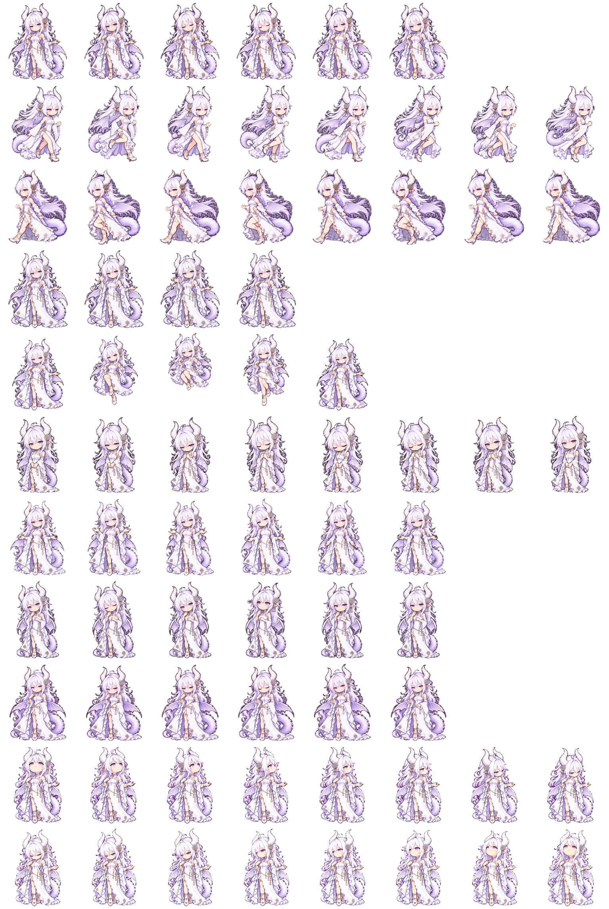

# GPT酱 · gpt-chan Codex Pet

白发紫瞳、白紫礼服的 GPT 龙娘，带有龙角、龙翼与鳞尾。本轮 `1.1.0-dev` 已将认可的形象制作成九动作、十六向注视的原生 v2 动画，气质从容、专注，略有俏皮。

原形象作者：**[ZipZipPipe（B站 UID 4168597）](https://space.bilibili.com/4168597)**。非官方 AI 辅助二创，来源与权利说明见 [NOTICE.md](NOTICE.md)。

[](https://github.com/NQBMotoki/gptchan-codexpet/actions/workflows/package.yml) · [最新 Release](https://github.com/NQBMotoki/gptchan-codexpet/releases/latest)

<table><tr>
<td align="center"><br>待机</td>
<td align="center"><br>工作中</td>
<td align="center"><br>完成庆祝</td>
</tr></table>

## 安装、诊断与恢复

下载 Release ZIP 或克隆仓库，进入解压目录／仓库根目录：

```powershell
# Windows；验证脚本需要 Python 3.10+，不需要 Pillow 或 API Key
powershell -NoProfile -ExecutionPolicy Bypass -File .\scripts\install.ps1
```

```bash
# macOS / Linux
bash scripts/install.sh
```

默认目标是用户目录的 `.codex/pets/gpt-chan/`，尊重 CODEX_HOME。新安装逻辑会先校验配置、WebP 头部、图集尺寸和登记哈希，在暂存目录准备完整包，备份旧目录后切换，普通异常恢复旧包。重复安装相同内容会跳过。备份位于 `CODEX_HOME/.pet-backups/gpt-chan/`。

**新增依赖：**为统一跨平台校验与恢复，验证脚本使用 Python 3.10+ 标准库。无 Python 可手动复制：源码中的 `output/gpt-chan/` 或 Release 中的 `gpt-chan/`，详见 [INSTALL.md](INSTALL.md)。

```text
python scripts/petctl.py doctor
python scripts/petctl.py backups
python scripts/petctl.py restore BACKUP_ID
python scripts/petctl.py uninstall
```

这些命令支持 `--codex-home PATH`。doctor 只读，输出本地路径、发行版本、服装 ID 和哈希完整性；不会把本地文件检查当作云端活动宠物检查。卸载也先保留备份。安装后重新打开应用并在 Pets 设置中选择 GPT酱。更多操作见 [docs/OPERATIONS.md](docs/OPERATIONS.md)。

发布包附 SHA256SUMS.txt。Windows 用 `Get-FileHash .\gptchan-codexpet.zip -Algorithm SHA256`；macOS 用 `shasum -a 256 gptchan-codexpet.zip`，与发布校验值比较。

## 换装与预览

同一 GPT酱 身份可以切换完整服装图集。当前只有完成的 `classic` 经典白紫礼服；后续新服装登记后复用相同验证、备份和恢复流程。

```text
python scripts/petctl.py outfits
python scripts/petctl.py install --outfit classic
```

每套服装都需要九种动作和十六向视线。登记命令、目录与哈希约定见 [换装说明](docs/OUTFITS.md)。切换不保证宿主热更新，也不会自动更新账号云端宠物。

双击 [preview.html](preview.html) 可离线预览服装、动作、逐帧、深浅背景和缩放，不依赖网站或 API。GitHub 页面上的 HTML 需要下载后打开。

## 本轮动画与形象依据

[九状态动态预览](art/animation/v2/previews/final/all-states.gif) · [十六向注视](art/animation/v2/previews/final/look-loop.gif) · [MP4](art/animation/v2/previews/final/all-states.mp4) · [本轮审看与验收](docs/ANIMATION-REVIEW.md)。全部预览从实际安装图集的相同编码字节渲染，播放速度用于审看。

[待机／等待样稿 v1](art/samples/gptchan-study-v1.png) 与 [七状态关键姿势](art/keyposes/v2/REVIEW.md) 已获使用者认可，是本轮动画的形象依据。十六向第二行采用使用者明确更喜欢的第一组，弃用侧脸变形的重绘稿。[形象基线](docs/ART-DIRECTION.md) 区分原作、社区参考和本项目解释；[生产记录](art/animation/v2/PRODUCTION.md) 保留生成、清理、配准与验收依据。

## 动作图鉴

| 预览 | 原生状态 | 语义 | 图集行（从 0 开始） | 帧数 |
| --- | --- | --- | --- | --- |
|  | `idle` | 待机 | 0 | 6 |
|  | `running-right` | 向右移动 | 1 | 8 |
|  | `running-left` | 向左移动 | 2 | 8 |
|  | `waving` | 互动反馈 | 3 | 4 |
|  | `jumping` | 跳跃／完成庆祝 | 4 | 5 |
|  | `failed` | 失败 | 5 | 8 |
|  | `waiting` | 等待确认 | 6 | 6 |
|  | `running` | 工作中 | 7 | 6 |
|  | `review` | 检查中 | 8 | 6 |

第 9–10 行包含 16 向视线，每行 8 格。各格尺寸为 **192 × 208**，整张图集为 **1536 × 2288**、8 列 × 11 行的透明无损 WebP。GIF 用于文档预览，播放速度不代表 Codex 运行器的实际速度。

<details><summary>完整精灵图集</summary>



</details>

## 验证与打包

```bash
python -m pip install -r requirements.txt
python scripts/build.py --no-previews
python scripts/verify_install.py
```

构建会完整解码全部登记服装，验证透明度、有效格、空白格，生成离线预览并打包 `dist/gptchan-codexpet.zip` 与 SHA256SUMS.txt。省略 --no-previews 可重新生成经典服装 PNG／GIF；构建本身不重绘图集。

ZIP 保留 `gpt-chan/` 手动安装目录，并附 scripts、docs、INSTALL.md、服装目录、版本记录和离线预览。release-info.json 中发行版本与素材格式 spriteVersionNumber=2 分开；记录哈希、服装与可取得的源码提交信息。

测试在隔离目录覆盖正常／异常安装、备份恢复、换装、路径、锁和可重复打包。CI 配置覆盖 Windows、Ubuntu、macOS；三个平台通过后复用 Linux 已验证 artifact 发布，避免重新构建另一份包。本轮新流程的实际验证状态见 [兼容性记录](docs/COMPATIBILITY.md)。

## 已知边界

动作触发、播放速度、鼠标跟随与资源刷新由宿主控制。结构或脚本测试通过不等于桌面显示已验收。断电或强杀进程后的恢复步骤、旧版备份说明见维护文档。安装工具不自动改后端设置。

本地桌面原生 v2 与网页上传分别验证，不自动裁切或转换图集。账号云端副本的更新需要宿主支持的更新流程，并保留既有稳定身份。

## English

GPT-chan is an unofficial white-dragon-girl pet based on ZipZipPipe's character design. It includes a native v2 atlas, nine animation states and sixteen gaze cells.

Download a release or clone this repository. Verified installation uses Python 3.10+ (standard library only): run scripts/install.ps1 on Windows or bash scripts/install.sh on macOS/Linux. Manual installation without Python remains available in [INSTALL.md](INSTALL.md).

The offline manager supports outfit selection under the same pet ID, integrity checks, backups, restore and read-only diagnostics. Only the classic dress is currently complete. Concept artwork is separate from installable atlases. See [NOTICE.md](NOTICE.md) for attribution and [compatibility](docs/COMPATIBILITY.md) for verification limits.

## 贡献与来源

修改前请阅读 [CONTRIBUTING.md](CONTRIBUTING.md)。包结构参考 [remielle-codex-pet](https://github.com/HanaAyane/remielle-codex-pet)，现有图集沿用本仓库所有者的 GPT酱 素材。新增维护工具不代表获得第三方角色素材的额外授权。
