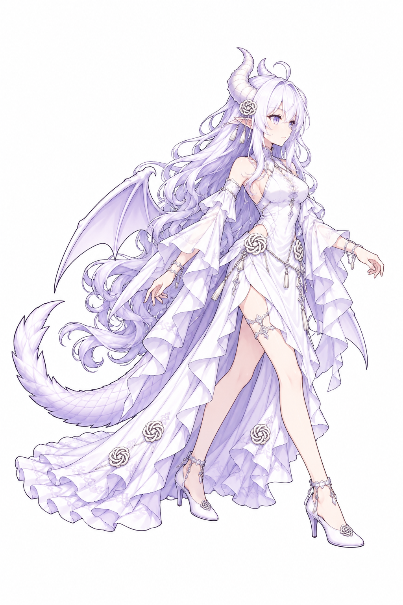
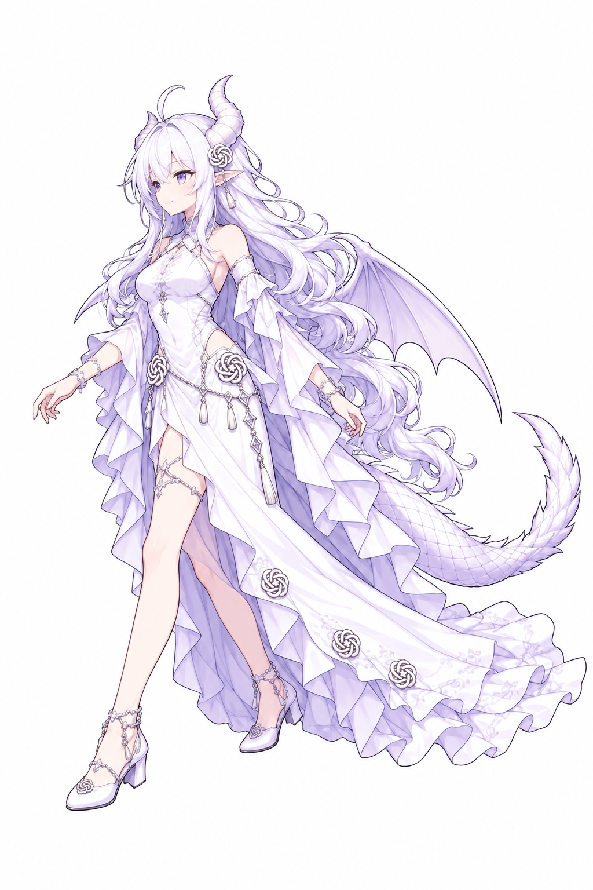
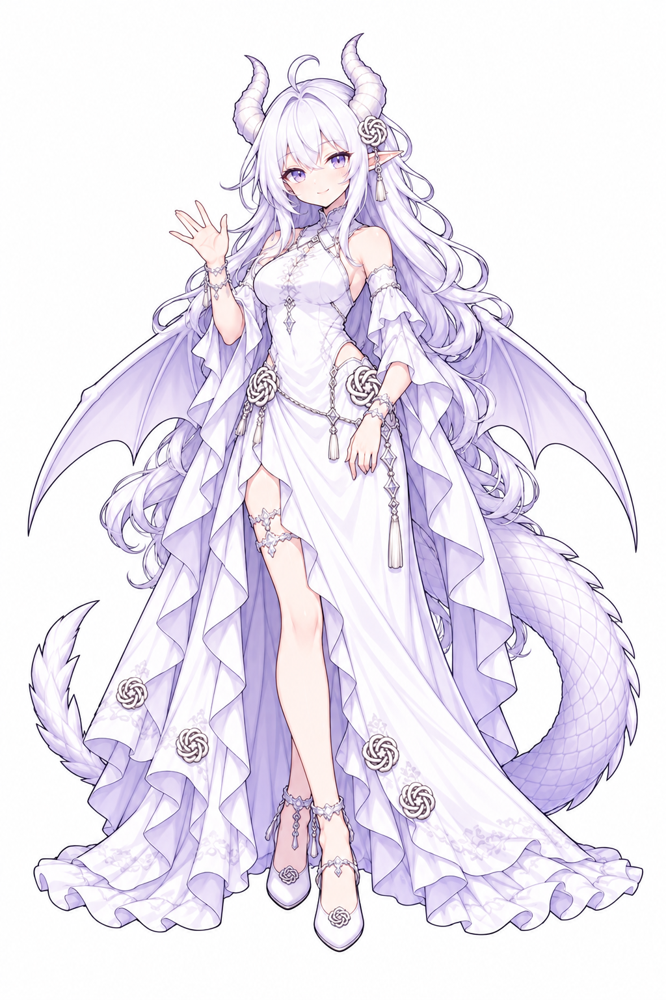
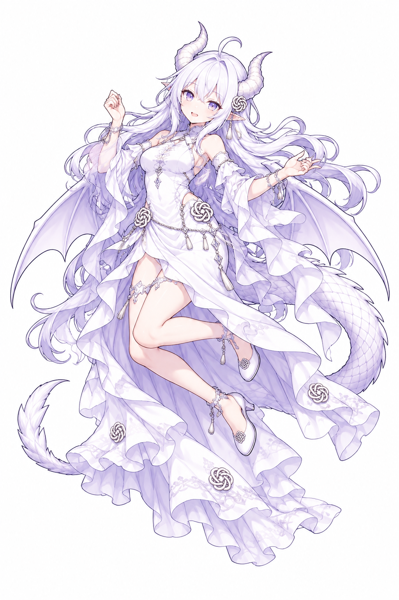
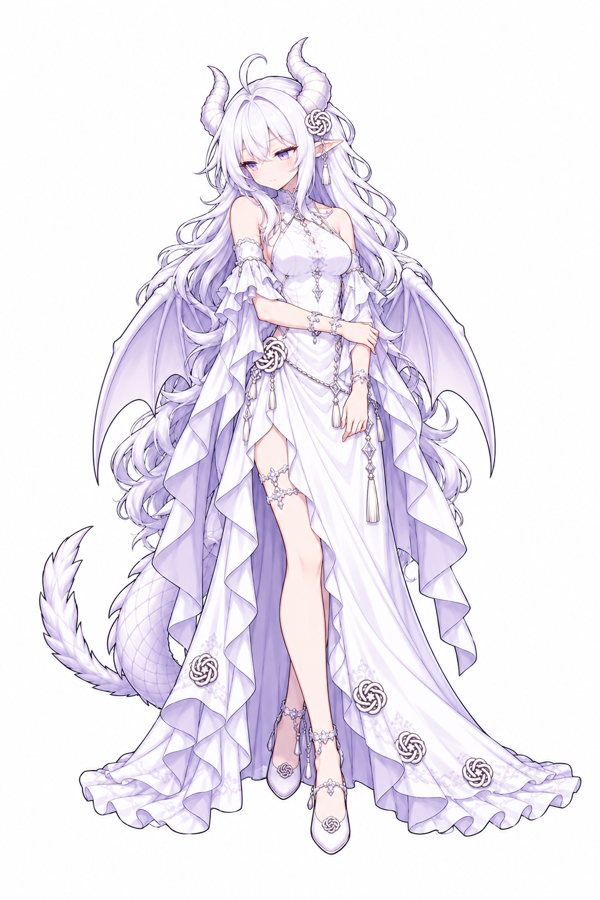
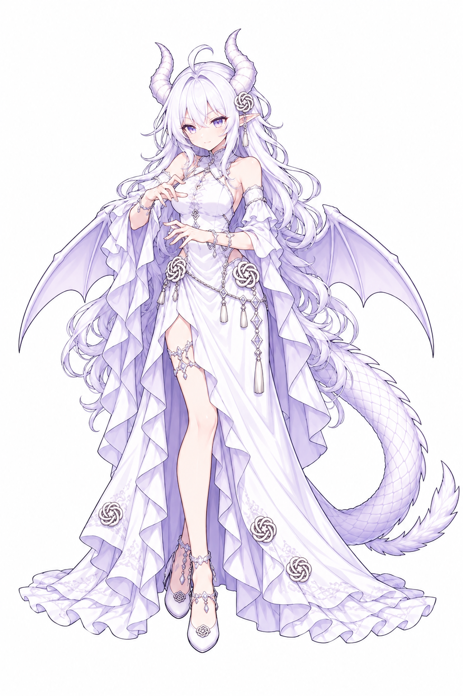
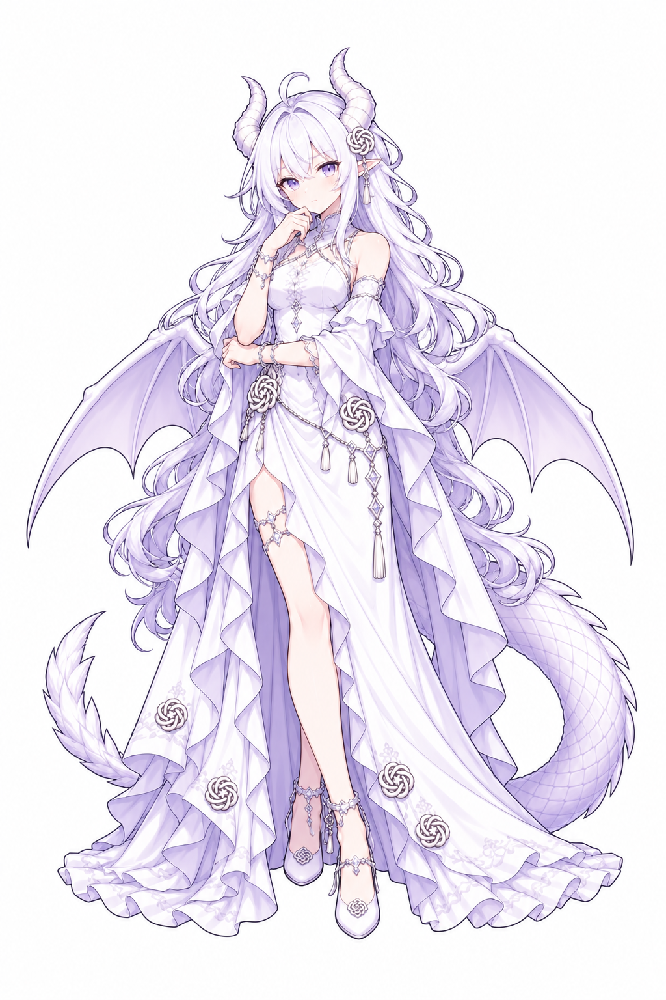

# GPT酱 v2：七状态关键姿势审稿

本批完成其余七种动作的第二轮单人物白底审稿图，统一为 1024×1536 RGB。制作工具为内置 imagegen。[完整提示词](prompts-pass2.json)、[文件元数据与哈希](qa-metadata.json)已保存。

已认可的待机／等待继续作为角色基线。使用者已通过本批七个姿势并授权进入动画制作；本文件保留关键姿势阶段的记录，后续进度见 [动画生产记录](../../animation/v2/PRODUCTION.md)。关键姿势获得认可不代表完整动画、透明图集或实机效果已验收。

## 集中比较

可双击 [review.html](review.html) 比较全部动作，并切换到整张图等比适配 192×208 的预览。白底审稿图不支持借深色衬底检查透明边缘；浏览器视觉渲染本轮未实测。

| 动作 | 本批表演 | 希望确认的重点 |
| --- | --- | --- |
| 向右移动 | 向画面右侧迈步，发丝与裙摆拖后 | 轻快感、头身比例、长裙运动方式 |
| 向左移动 | 向画面左侧迈步 | 与右行是否为同一角色、同一尺度 |
| 挥手 | 肩侧小幅挥手，克制微笑 | 亲和感与从容感是否平衡 |
| 跳跃／完成庆祝 | 跳跃最高点、屈膝、微张口 | 腾空姿态与表情是否合适 |
| 失败 | 轻微皱眉、视线偏下、短暂停顿 | 是否显得过于委屈或低落 |
| 工作中 | 双手在身前作处理动作，注意力集中 | 是否能读作工作进行中 |
| 检查中 | 托下巴、评估性目光 | 与工作／等待是否有足够区别 |

## 本批自查

- 第二轮均为单人物，主要身体、鞋、翼尾与裙摆完整可见，未见首轮的局部截断；各图留白仍需在最终帧排版时统一。
- 主要脸部、白紫礼服、银饰、龙角／翼膜／鳞片尾延续了已接受的方向。腰部链坠长度、细小结形纹饰和裙摆褶皱尚有生成差异，动画生产前应固定标准，不能把这些差异直接作为相邻帧。
- 左右行进的姿势已经区分，但尚不能证明步态循环、落脚节奏和服装侧面遮挡已正确。
- 工作姿势采用无道具的手势表现，可能带有施法感；检查采用托下巴。需要结合使用者对角色的理解审看这两种表现。
- 跳跃保留了微张口与腾空方向。单张姿势不能证明跳跃高度、起跳／落地衔接及身体中心稳定。
- 本批特意使用白底高分辨率审稿图；它们不是可直接注册的原生透明服装包。

## 七张审稿图

### 向右移动

### 向左移动

### 挥手

### 跳跃／完成庆祝

### 失败

### 工作中

### 检查中

原角色形象：ZipZipPipe。本批为本项目 AI 辅助二创，角色气质与动作是本项目的设计解释，未声称由原作者确认。第一轮探索提示词保留在 prompts.json；探索图本地保留在 drafts/，没有选作当前审稿稿件。
